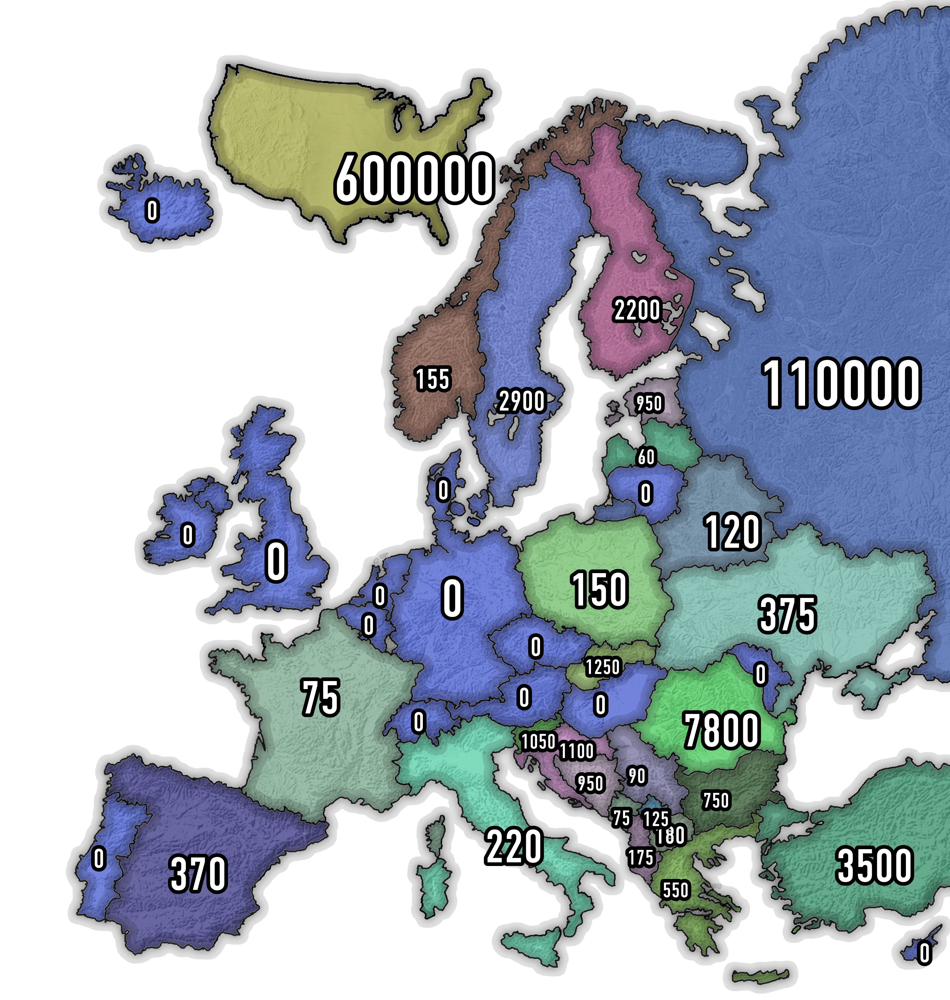
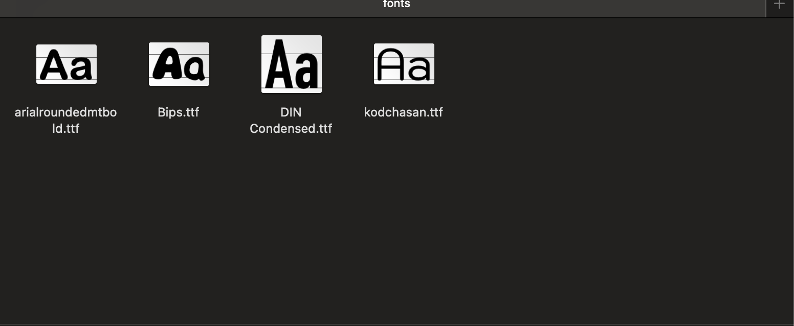

# AutoMap-cli (AutoMap v2.0)


**AutoMap** is a map-generating tool. Describe what you want in plain language and AutoMap uses AI to collect the data, then paints it onto a map for you — a coloured, labelled map in seconds.

It ships with three parts:

- a **CLI** (`cli.py` / the `automap` command),
- a **web UI** (a small Flask app in `main.py`),
- and a Python API (`map.auto_map.auto_map`).

## Features

AutoMap can render three map types:

| Map type  | Description                     |
| --------- | ------------------------------- |
| `default` | Europe (default map)            |
| `flag`    | Europe with flag-style borders  |
| `world`   | World map grouped by continent  |

Data can be shown in two modes:

- **`text`** — categorical values (e.g. `Coffee` → a specific colour).
- **`number`** — numeric values, coloured by value ranges.

Optional extras:

- `show_most_least` — highlight the country/continent with the most and least of a value.
- `short_form` — shorten large numbers (e.g. `1000000` → `1M`).

Here is an example (*default map*):



## Stack

Libraries AutoMap uses today:

- **AI**
  - [google-genai](https://github.com/googleapis/python-genai)
- **Drawing**
  - [pillow](https://github.com/python-pillow/Pillow)
- **Web UI**
  - [flask](https://github.com/pallets/flask)
- **CLI**
  - [click](https://github.com/pallets/click)
  - [rich](https://github.com/Textualize/rich)
- **Other**
  - [python-dotenv](https://github.com/theskumar/python-dotenv)

## Installation

To get started with **AutoMap**, follow these steps:

1. **Clone the repository:**
   ```bash
   git clone https://github.com/deltaaa00/auto_map.git
   cd automap
   ```

2. **Set up a virtual environment:**
   ```bash
   python -m venv venv
   # Windows:
   venv\Scripts\activate
   # macOS / Linux:
   source venv/bin/activate
   ```

3. **Install dependencies:**
   ```bash
   pip install -r requirements.txt
   ```

4. **Configure your API key:**
   AutoMap reads `GEMINI_API_KEY` from a `.env` file (see `example.env`).
   - Copy `example.env` to `.env`.
   - Get a key from [Google AI Studio](https://aistudio.google.com/apikey).
   - Set it in `.env`: `GEMINI_API_KEY=your_key_here`.

   On Windows/macOS you can also use the helper scripts in `util/` (`key_man.bat`, `key_man.command`) to manage the key.

5. **Create your filling configuration:**
   Copy the template so colours can be applied:
   ```bash
   cp map/filling.template.json map/filling.json
   ```

## Usage

### Web UI

Start the Flask server:

```bash
python main.py
```

Then open <http://127.0.0.1:5000/> in your browser. If no key is found in `.env`, the UI prompts you to paste one; otherwise it uses the key from `.env` automatically.

### CLI

Generate a map straight from the terminal:

```bash
python cli.py make "Population of European countries" -m number -mp default
```

Flags:

- `-m, --mode` — `text` (default) or `number`
- `-mp, --map-type` — `default` (default), `flag` or `world`
- `-gsm, --global-size-modifier` — global font size modifier (default `15`)
- `-eop, --extra-option` — `none` (default), `show_most_least` or `short_form`
- `--model` — AI model to use
- `--font` — font file name from `resources/fonts`
- `--show/--no-show` — open the result image after generating
- `-v, --verbose` — print detailed progress output

After installing the package (`pip install -e .`) you can also use the `automap` command:

```bash
automap make "Population of European countries" -m number -mp default
```

The result is saved as `result.png`.

## Fonts

AutoMap ships with a few default fonts. You can drop your own `.ttf` / `.otf` files into `resources/fonts` and select them on the map.



## Filling

You can define colours for your data in `map/filling.json`. It contains two dictionaries:

- **`filling_txt`** — colours for `text` mode. For example, if the data is `Tea`, the colour is `(246, 255, 0, 255)`.
- **`filling_num`** — colours for `number` mode, keyed by value ranges. For example, `(100,200)` means *value > 100 and value <= 200* → `(235, 40, 33, 255)`.

> AutoMap uses **RGBA**. The last number must be `255`.

```json
{
    "filling_txt": {
        "Tea": [246, 255, 0, 255],
        "Coffee": [54, 4, 4, 255]
    },
    "filling_num": {
        "(100,200)": [235, 40, 33, 255]
    }
}
```

## Deployment (Vercel)

The web UI can be deployed to Vercel. The repository root contains a `vercel.json` that builds `AutoMap-cli/main.py` with the Python runtime.

1. Set `GEMINI_API_KEY` under **Project → Settings → Environment Variables** (do **not** commit a `.env`).
2. Deploy. If no key is configured, the UI simply prompts the visitor for one.

Note that AI + image generation can be slow, and Vercel's Hobby plan has short function time limits — a paid plan may be needed for larger requests.

## License

This project is licensed under the **Apache License 2.0**.

Copyright © 2025-2026 **deltaaa00**.

Licensed under the Apache License, Version 2.0 (the "License");
you may not use this file except in compliance with the License.
You may obtain a copy of the License at

    http://www.apache.org/licenses/LICENSE-2.0

Unless required by applicable law or agreed to in writing, software
distributed under the License is distributed on an "AS IS" BASIS,
WITHOUT WARRANTIES OR CONDITIONS OF ANY KIND, either express or implied.
See the License for the specific language governing permissions and
limitations under the License.
