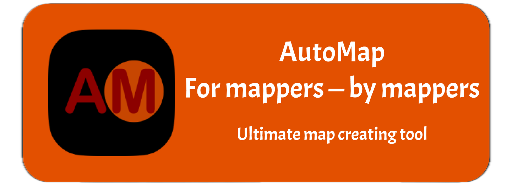
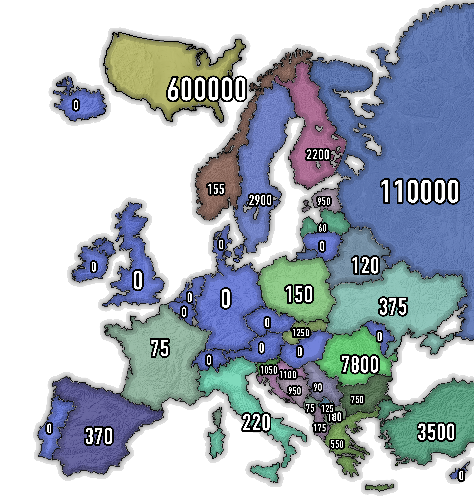

<!--
Copyright 2025-2026 deltaaa00

Licensed under the Apache License, Version 2.0 (the "License");
you may not use this file except in compliance with the License.
You may obtain a copy of the License at

    http://www.apache.org/licenses/LICENSE-2.0

Unless required by applicable law or agreed to in writing, software
distributed under the License is distributed on an "AS IS" BASIS,
WITHOUT WARRANTIES OR CONDITIONS OF ANY KIND, either express or implied.
See the License for the specific language governing permissions and
limitations under the License.
-->

# AutoMap



AutoMap turns a natural-language topic into a colored, labeled map and can place that map in a short portrait video. It includes a web interface, a command-line interface, and a Python renderer.

Choose **Google Gemini** or **DeepSeek** for map data. Customize the palette and labels, generate several maps from a CSV file, or open **Video Studio** to combine a map with background footage, a headline, branding, and optional music.

AI-generated values can be approximate or incorrect. Check the underlying data before publishing a map; a prompt asking for current information does not guarantee verified sources or live web research.

## What you can make

| Map type | Coverage | Appearance |
| --- | --- | --- |
| `default` | European countries, with the regions included in the bundled artwork | Filled regions with relief and borders |
| `flag` | The same European layout | Flag artwork with labels |
| `world` | Continents | Filled continent regions with relief and borders |

Maps support categorical **text** values and **number** values. Numeric palettes preserve decimal values and interval boundaries. Short numeric strings such as `10k`, `2.5M`, and `1B` are understood by numeric coloring and Most/Least calculations.

The web interface provides:

- Separate **Gemini** and **DeepSeek** sections in the model selector, with independent API keys.
- Single-map generation and CSV batch generation.
- **Theme & Style** in the left panel, opening Color Filling Studio for palettes, category rules, numeric intervals, and label styling.
- Repainting from an existing map's values without another AI request.
- Palette inspection from an uploaded image. This samples colors; it does not recover the image's underlying country data.
- PNG downloads, run history, and transfer of the latest generated map to Video Studio.
- Video Studio at `/studio`, with title previews, custom overlays, music download/upload and trimming, and MP4 rendering.



## Quick start with Docker

Docker Compose starts both required services: the web application and the media worker. The worker image includes FFmpeg, Node.js, and the Python media dependencies.

```sh
git clone https://github.com/deltaaa00/AutoMap-cli.git
cd AutoMap-cli
git switch dev
cp example.env .env
```

Edit `.env`. Configure either API key, both keys, or leave their placeholder values and enter a key in the browser instead. Set your own login credentials before exposing the app to other users.

```dotenv
GEMINI_API_KEY=your_google_ai_studio_key
DEEPSEEK_API_KEY=your_deepseek_api_key
SERVER=TRUE
WEB_LOGIN=your_username
WEB_PASSWORD=your_password
# Optional: use a stable, random signing secret instead of the generated file.
# WEB_SECRET_KEY=your_long_random_secret
```

```sh
docker compose up --build -d
```

Open [http://localhost:3000](http://localhost:3000). For local HTTP testing with `SERVER=TRUE`, set `WEB_COOKIE_SECURE=FALSE` if your browser requires it. For an HTTPS deployment, keep the default Secure cookie setting.

Useful commands:

```sh
docker compose logs -f web yt-dlp-worker
docker compose up --build -d    # Apply code, dependency, or configuration changes.
docker compose down            # Stop and remove containers; retain named volumes.
```

Compose binds the web application to `127.0.0.1:3000` by default. Set `AUTOMAP_BIND_ADDRESS` if your reverse proxy or deployment needs a different interface. The media worker listens on `8080` inside the private Compose network. Both services use `restart: unless-stopped`.

The `automap-session` volume retains the generated session secret. The `automap-media` volume stores worker media, which is still subject to expiry cleanup. Removing a volume removes its contents.

## API keys and model selection

Get a key from [Google AI Studio](https://aistudio.google.com/apikey) or the [DeepSeek platform](https://platform.deepseek.com/).

| Provider section | Server setting | Built-in default or fallback |
| --- | --- | --- |
| Gemini, including available Gemma models | `GEMINI_API_KEY` | Default: `gemini-3.8-flash` |
| DeepSeek | `DEEPSEEK_API_KEY` | `deepseek-flash`, `deepseek-v4-pro` |

The web app requests the models available for the active provider's key and keeps built-in options if discovery is unavailable. Model availability, quota, and billing depend on the provider and account. Use `python cli.py make --help` to see the CLI's supported model choices.

Keys can come from the process environment or the project-root `.env` file. Environment settings take precedence over file settings. Compose forwards both provider keys from its launching environment or `.env`.

In the browser:

1. Choose a model from the **Gemini** or **DeepSeek** section.
2. Open **API Manager** to save a key for each provider that has no server key.
3. Return to the map generator. It reads the matching saved key automatically when you select a model. Key entry and removal are available only in API Manager.

Browser-supplied keys are sent to the application server for the active provider's requests. Server-configured keys are not returned to the browser. Browser persistence requires storage to remain enabled; it is specific to the browser profile and site origin.

DeepSeek uses its official Chat Completions API with JSON output and thinking disabled for map generation. No separate OpenAI SDK is required. API requests have a 45-second timeout and no application-level automatic retry. Map drawing takes additional time. Provider overload, quota limits, invalid credentials, insufficient DeepSeek balance, and timeouts are reported in the interface.

Enable **DeepSeek Web Search** to search across websites using [Tavily](https://docs.tavily.com/documentation/api-reference/endpoint/search) or [Brave Search](https://api-dashboard.search.brave.com/api-reference/web/search/get). Enter your Tavily key in **API Manager → Web search**. It is saved in this browser across reloads, sent only when DeepSeek search is enabled, and excluded from map history. Use **Remove browser key** in API Manager to remove it. A supplied Tavily key overrides the server search provider for that request. Alternatively, configure a separate search-service key on the server:

```dotenv
WEB_SEARCH_PROVIDER=tavily
TAVILY_API_KEY=your_tavily_api_key
# Alternatively: WEB_SEARCH_PROVIDER=brave and BRAVE_SEARCH_API_KEY=your_brave_search_api_key
```

Open **API Manager** (`/api-manager`) from the map generator or Video Studio to manage Gemini, DeepSeek, and Tavily browser keys, see server configuration status, and connect or disconnect YouTube with your Google OAuth client JSON. Browser keys use the same storage as the map generator. The web-search toggle and maximum search count are saved across reloads and shared between both pages. YouTube authorization returns to the manager when started there; video upload settings remain in Video Studio.

Restart the application (recreate the web container for Docker). If no provider is selected, a configured Tavily key takes precedence over Brave. Search credentials stay on the server and are independent of the DeepSeek key. Queries are sent to the selected search service; titles, source URLs, snippets, and available dates are passed to DeepSeek. The first search is required; further searches share the selected limit of 1–10 calls. Missing configuration, quota errors, or provider failures stop generation with an error instead of silently using Wikipedia or model knowledge. Each search has a 20-second read timeout in addition to model request timeouts. Search services may charge per request.

Search snippets do not guarantee accurate or current values. The model is instructed to prefer primary sources, check years, and use null for unsupported values. Source URLs currently go to the model; the map output and UI do not include a source bibliography. Cached map answers can be reused; API clients can set `refresh_ai: true` to research again.

DeepSeek receives the total search-call budget in its system prompt and updated `total`, `used`, and `remaining` counts in every tool result. This limit applies to one map, not the search provider's monthly account quota. Server console logs show each actual query, its number, result count, and remaining budget, even with verbose logging disabled. Each research run has an ID so concurrent maps can be distinguished. For Docker, follow them with `docker compose logs -f web`. Cached answers do not run new searches.

## Run from the source checkout

Use **Python 3.12**, matching the Docker images and test workflow. Keep the repository's `resources/` directory available: the renderer uses its map artwork and fonts.

```sh
python3.12 -m venv .venv
source .venv/bin/activate
# Windows PowerShell: .venv\Scripts\Activate.ps1
python -m pip install -r requirements.txt
```

For map generation through the CLI, this is enough once an API key is configured. To use the `automap` entry point while keeping assets in the checkout:

```sh
python -m pip install -e .
```

For native Video Studio operation, also install FFmpeg and make its executable available on `PATH`. URL audio downloads use the `yt-dlp` executable installed by the requirements; Node.js is also included in the Docker worker for supported download workflows. Docker is the simplest way to run the complete media stack.

To run the web app and worker outside Compose, start them in separate terminals from the project root. Activate the virtual environment in each terminal.

```sh
# Terminal 1: media worker, default port 8080.
python yt-dlp_serv.py
```

```sh
# Terminal 2: web app, default port 5000.
export YTDLP_URL=http://127.0.0.1:8080
python main.py
```

On PowerShell, set the worker URL with `$env:YTDLP_URL = 'http://127.0.0.1:8080'`. Open [http://localhost:5000](http://localhost:5000).

Only the exact value **`SERVER=TRUE`** enables production mode: Waitress, debugging off, and web authentication. Other values use Flask's development server with debugging enabled and no login gate. The supplied `example.env` enables production mode.

## Web workflow

### Generate and style a map

Choose a model, enter a topic, and select text or numeric mode and a map type. Adjust font size, font, temperature, and the optional feature, then generate.

Open **Theme & Style** from the left panel to choose a palette or edit category colors, numeric ranges, and label appearance. **Apply & Re-Paint Current Map** reuses the generated values, so changing colors does not require another AI call. Selecting a batch result restores its generation parameters before repainting it.

The **Global label position** slider in the main left panel moves all country or
continent labels horizontally, from −500 to +500 pixels. Negative values move
left; positive values move right. The value is remembered in this browser. Use
**Apply & Re-Paint Current Map**, next to the generation controls, to apply the
shift without another AI request. The slider's **Reset** restores zero offset.

The generated map's topic travels with its image into Video Studio and fills the
video headline automatically. Batch selection and restored history use the topic
of the selected map. Headlines you edit manually are kept when returning to the
studio or selecting another generated map.

The temperature slider accepts `0`–`2` and defaults to `0.75` in the web UI. It controls sampling where the selected model supports it; it does not ensure factual accuracy, and some models manage sampling themselves.

The browser remembers API keys, the last topic, and palette preferences. Video Studio also stores selected materials and settings locally. Storage limits or disabled storage can prevent persistence; download important outputs rather than treating browser storage as an archive.

**Run History** is saved in this browser's IndexedDB with map images, values, and
generation settings, but without API keys. It survives reloads and reopening the
site. Runs older than 24 hours are removed when the page opens and checked every
minute while it is open. **Clear History** removes the saved history as well.

### Create a portrait video

1. Generate a map or select a map image in Video Studio.
2. Supply background footage and a headline.
3. Optionally download audio from a YouTube video link or upload MP3, WAV, M4A, AAC, OGG, or FLAC audio. Uploaded music is converted to MP3.
4. Use a full track or trim a **1–30 second** segment from an `MM:SS` start time.
5. Configure title font, size and colors, watermarks, stickers, and other overlays, then render and download the MP4.

The worker renders a **1080 × 1920** portrait frame. Video duration is limited to **1–30 seconds** and to the available source media. Without selected music, rendering can proceed without audio; background footage's original audio is removed.

The CPU encoder is `libx264`. NVIDIA `h264_nvenc` and macOS `h264_videotoolbox` are selectable only when detected by the worker. Installing an encoder does not guarantee compatible hardware or drivers.

During rendering, a progress bar shows the worker's audio/video encoding progress
and current phase. It reaches 100% only after the finished MP4 is ready. The
sticker library also includes mountains, volcanoes, islands, weather, robots,
satellites, laptops, graduation caps, medals, cats, dogs, fish, burgers, and trains;
these have offline artwork as well as the existing sticker styles.

Maps, background footage, audio, and custom overlay materials have a **10 MiB per-material limit**. URL downloads are also rejected if the resulting MP3 exceeds that limit. A long track may therefore need to be replaced with a shorter source. Each audio download has a unique identifier, independent of its display title.

Worker files older than approximately **30 minutes** are cleaned up when relevant operations run. Download completed videos promptly. Browser-restored inline audio can keep a selected track usable after worker files have expired, subject to browser storage availability.

### Upload rendered videos to YouTube

1. Install the updated `requirements.txt` (or rebuild the Docker containers).
2. In Google Cloud Console, enable **YouTube Data API v3**, configure the OAuth consent screen and, while the app is in testing, add your Google account as a test user. Download an **OAuth client secret JSON** file.
3. Open **API Manager → YouTube Data API**, choose the JSON file, and click **Connect Google / YouTube**. Approve access to the desired channel.
4. The YouTube title follows the video topic by default (up to 100 characters). Disable **Use the video topic as the YouTube title** to enter a custom title. Set the description, comma-separated tags, visibility, and the made-for-kids setting.
5. Enable **Automatically upload after rendering**, then render. AutoMap uploads the resulting MP4 in the background and shows progress and a YouTube link. You can also click **Upload rendered video to YouTube** after rendering. Visibility defaults to **Private**. Metadata, custom title, title mode, and the automatic upload setting are saved in this browser and restored when you return.

AutoMap renders vertical 9:16 videos lasting up to 30 seconds, which meet the
[YouTube Shorts format requirements](https://support.google.com/youtube/answer/15424877?hl=en).
YouTube classifies the upload after processing; the Data API has no separate
Shorts switch. The completed upload links to the Shorts player.

For `localhost`, either a **Desktop app** or **Web application** client works.
For a hosted server, use a **Web application** client and register the exact
redirect URI displayed in the panel under **Authorized redirect URIs** in Google
Cloud Console. The hosted URL must use HTTPS. Behind a reverse proxy, set
`YOUTUBE_REDIRECT_URI=https://your-host/api/youtube/callback` in the server
environment (or Docker Compose `.env`) to match the public URL. Google setup and
upload behavior are described in the [official upload guide](https://developers.google.com/youtube/data/guides/uploading_a_video).

Each browser profile has its own YouTube connection. Two people using separate
browsers or profiles can supply different client files, authorize different
channels, and upload concurrently. Credentials and pending OAuth secrets are
stored **encrypted** in `instance/youtube/`, with private file permissions;
Google tokens and client secrets are never sent back to the browser, saved in
localStorage, or forwarded to the media worker. A signed browser session selects
its own credentials and upload jobs. Sharing a browser profile shares this
connection; clearing cookies, logging out, or changing the web login requires
connecting again. **Sign out of YouTube** deletes that browser's saved credentials; it
does not cancel an upload already started or revoke the grant in Google Account.
Sign in again to choose a different Google account.

For persistent server storage, retain the `automap-session` Docker volume (it
already mounts `/app/instance`). For native deployment, back up `instance/` and
retain its session secret, or configure a stable `WEB_SECRET_KEY`. Encryption
uses a separate key derived from that secret; replacing it makes existing
credentials unreadable. Run a single web process, as in the supplied Waitress
configuration. Up to two background uploads run at once. Upload status and
in-progress transfers live in that process; a server restart preserves the saved
Google connection but interrupts active transfers. Check YouTube Studio before
starting a new upload after an interruption. Upload errors leave the rendered
MP4 available for download. The same render cannot be uploaded twice in the
running process, and worker file expiry still applies.

## Command-line usage

Run commands from the repository root:

```sh
python cli.py make "Population of European countries" -m number -mp default
python cli.py make "Most popular hot drink by country" -m text --model deepseek-flash
python cli.py make "GDP per capita by country" -m number -eop show_most_least --temperature 0.4
```

`make` saves `result.png` in the repository root, replacing an existing result. `--show` opens the image after generation; it is off by default.

| Option | Values or purpose | Default |
| --- | --- | --- |
| `-m`, `--mode` | `text`, `number` | `text` |
| `-mp`, `--map-type` | `default`, `flag`, `world` | `default` |
| `-gsm`, `--global-size-modifier` | Integer font-size adjustment | `15` |
| `-eop`, `--extra-option` | `none`, `show_most_least`, `short_form`, `show_most_least,short_form` (either order) | `none` |
| `--legend` | Draw a color legend | off |
| `--model` | Supported model ID; see command help | `gemini-3.8-flash` |
| `--font` | Bundled `.ttf` or `.otf` filename | `Bips.ttf` |
| `--key` | Key for the selected model's provider | Provider environment/file key |
| `--temperature` | Sampling value from `0` to `2`; `make` only | Provider default when omitted |
| `--show` / `--no-show` | Open the generated image; `make` only | `--no-show` |
| `-v`, `--verbose` | Detailed progress output | Off |

`show_most_least` is supported in **numeric mode** on `default`, `flag`, and `world_countries` maps. `short_form` displays shortened values such as `1k` or `2M` in either mode. Combine them with `-eop show_most_least,short_form`; extrema use the original values before display rounding. Add `--legend` to show the color key.

### Batch generation

Start with [batch_template.csv](batch_template.csv), or create a UTF-8 CSV:

```csv
prompt,mode,map_type,gsm,extra_option,model,font,palette_theme,output
"Population density in Europe",number,default,15,none,gemini-3.8-flash,Bips.ttf,viridis,europe_density.png
"Most popular drink in Europe",text,default,15,none,deepseek-flash,Bips.ttf,categorical,europe_drinks.png
```

```sh
python cli.py batch batch_template.csv -o output_maps
```

Only `prompt` is required. Optional columns are `mode`, `map_type`, `gsm`, `extra_option`, `model`, `font`, `palette_theme`, and `output`. Unknown or duplicate columns and invalid values are rejected. CSV `gsm` must be an integer from `1` to `100`. Blank optional cells use command or web-form defaults.

The batch command accepts the shared map/model/font/key/verbosity options above, plus `-o` / `--output-dir` (default: `output_maps`). It does not expose `--temperature` or `--show`. Rows run sequentially. Without `output`, filenames use a row number and a slug of the prompt; an explicit filename is confined to the output directory and given a `.png` extension if needed.

Mixed-provider CSV files need credentials for each provider. A key entered in the browser or passed through CLI `--key` is applied only to its selected provider; it is not forwarded to the other provider. Configure both server/environment keys for mixed-provider batches.

The web interface also accepts CSV ideas files and provides individual PNG downloads. Batch results remain available in the current page's result list and history.

## Filling configuration and Python API

If `map/filling.json` is absent, AutoMap reads the bundled `map/filling.template.json`. To maintain your own default rules:

```sh
cp map/filling.template.json map/filling.json
```

`filling_txt` maps text labels to RGBA arrays. `filling_num` maps stringified `(low, high)` pairs to RGBA arrays, using **`low < value <= high`**. Fractional interval boundaries are supported. The web editor can export a filling configuration.

For Python use, the renderer accepts model/key settings, style overrides, and optional supplied values:

```python
from map.auto_map import auto_map

png = auto_map(
    prompt="Example values",
    mode="number",
    map_type="default",
    size_mod=15,
    optional_feature="show_most_least",
    model="gemini-3.8-flash",
    font_name="Bips.ttf",
    show_result=False,
    io_res=True,
    auto_style=True,
    palette_theme="viridis",
    ai_answer_override={"ukraine": "2M", "poland": 100000},
)
if png is not None:
    with open("example.png", "wb") as output:
        output.write(png.getvalue())
```

`ai_answer_override` bypasses AI entirely. With `io_res=True`, a successful call returns a PNG `BytesIO` buffer; otherwise it saves and returns the path to `result.png`. Omitted countries or continents are not populated by this example.

## Server configuration

| Variable | Purpose |
| --- | --- |
| `GEMINI_API_KEY` | Server key for Gemini/Gemma models |
| `DEEPSEEK_API_KEY` | Server key for DeepSeek models |
| `SERVER` | Defaults to local mode (`FALSE`). Exact `TRUE` enables Waitress and web authentication |
| `WEB_LOGIN` | Login name, required in server mode |
| `WEB_PASSWORD` | Unique login password, required in server mode |
| `WEB_COOKIE_SECURE` | Defaults to `TRUE` in server mode. Set `FALSE` only for a trusted HTTP-only setup |
| `WEB_TRUSTED_HOSTS` | Additional comma-separated hostnames accepted in unauthenticated local mode |
| `BIND_HOST` | Native listening address, default `127.0.0.1` |
| `AUTOMAP_BIND_ADDRESS` | Compose host listening address, default `127.0.0.1` |
| `WEB_SECRET_KEY` | Optional stable session-signing secret |
| `WEB_AUTH_SECRET_FILE` | Native deployment override for the generated secret file |
| `PORT` | Native service port; web default `5000`, worker default `8080` |
| `YTDLP_URL` | Native default `http://127.0.0.1:8080`; Docker Compose sets `http://yt-dlp-worker:8080` |

Local mode is enabled by default, including in `example.env`. Its YouTube callback
uses the current local host and port (`localhost:3000` with Compose, or
`localhost:5000` for a native web launch), ignoring a leftover hosted callback.
The server keeps `SERVER=TRUE` and its public `YOUTUBE_REDIRECT_URI` in its own
`.env`; these deployment values survive GitHub Actions updates.

Login sessions are valid for up to a year. Changing the credentials or signing secret invalidates existing sessions. Without `WEB_SECRET_KEY`, a secret is generated in `instance/web-session-secret`; keep that file across native restarts or retain the Compose session volume. For Compose, add an explicit environment entry to use `WEB_AUTH_SECRET_FILE`. Compose already fixes `YTDLP_URL` to the private worker address; edit that entry only if you change the service layout.

Use your own credentials and HTTPS for a public deployment. If you used the old built-in password, choose a new one before upgrading. Keep the media worker private; the web application provides the login gate. After changing Compose environment values, run `docker compose up -d` to recreate affected containers: `docker compose restart` retains the old values.

## Tests

The suite mocks external AI/HTTP downloads and does not require real credentials. It covers map rendering, decimal ranges and extrema, CLI/CSV behavior, provider/key isolation, authentication, service proxies, media handling, and browser interaction. Real software-encoded video rendering is included; live model/YouTube availability and GPU encoders are not tested.

```sh
python -m pip install -r requirements-test.txt
python -m playwright install chromium
python -m pytest --cov --cov-report=term-missing
```

On Linux, install browser system dependencies with `python -m playwright install --with-deps chromium`. On macOS, browser tests use installed Google Chrome when available, otherwise Playwright Chromium.

```sh
python -m pytest -m 'not browser'  # Python checks without launching a browser.
python -m pytest -m browser        # Browser interaction checks only.
```

The coverage configuration requires **85%** coverage. See [tests/README.md](tests/README.md) for isolation details and test setup. The GitHub Actions workflow runs on pushes and pull requests targeting `main`.

## Troubleshooting

- **AI overload, timeout, or quota error:** retry later or select another available model. Drawing and encoding still take time after the AI response; AutoMap does not guarantee a fixed generation time.
- **API key missing:** open API Manager to save a key for the selected provider. Gemini and DeepSeek credentials are independent.
- **Video or music requests cannot reach the worker:** check `YTDLP_URL` for native launches and inspect `docker compose logs yt-dlp-worker` for Compose.
- **Audio download or conversion fails:** verify FFmpeg/yt-dlp availability, the source URL's accessibility, and the resulting file size. External sites may change or restrict downloads.
- **Files or preferences disappear after reopening:** browser storage may be disabled, cleared, or full; worker files also expire. Keep downloaded copies of important material.
- **A custom font or map asset is missing:** run from the source checkout and retain `resources/fonts/` and `resources/maps/`.

## License

[Apache License 2.0](LICENSE).
